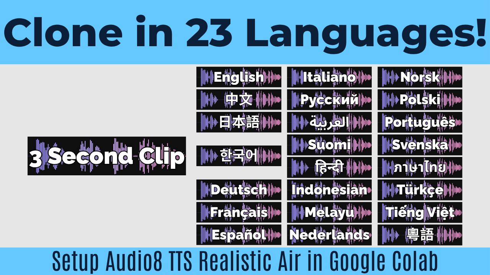

# 🗣️ Audio8-TTS-Realistic-Air in Google Colab

This repository contains a streamlined Google Colab notebook designed to run the **Audio8-TTS-Realistic-Air** model. You can easily generate high-quality text-to-speech in multiple languages or clone any voice using just a short `.wav` audio sample, all completely free on a Google Colab T4 GPU.

**🎥 Watch the Tutorial:** [How to Use](https://www.youtube.com/watch?v=x0fmsiRrn2M)

**🚀 Run in Colab:** [Open Google Colab Notebook](https://colab.research.google.com/drive/1T-5wHOoUVLSM5gcW157dVk-yqllVCR9C?usp=sharing)

---

## ✨ Features Supported in this Notebook

* **Standard Text-to-Speech**: Generate natural-sounding speech in 23 languages, including English, Chinese, Japanese, Spanish, French, and Hindi.
* **Zero-Shot Voice Cloning**: Upload a short `.wav` reference file, provide its exact transcript, and clone the speaker's voice to read any new text.
* **T4 GPU Optimized**: Runs flawlessly on the free tier of Google Colab.
* **Adjustable Generation Controls**: Fine-tune your audio output using sliders for temperature, top_p, top_k, and max_new_tokens.

## 🛠️ How to Use

1. Click the "Open in Colab" badge above.
2. Go to **Runtime > Change runtime type** and ensure a **T4 GPU** is selected.
3. Run **Cell 1** to install the required libraries like PyTorch, Torchaudio, and Transformers.
4. Run **Cell 2** to download and load the `Edge0/Audio8-TTS-Realistic-Air` model into the GPU memory.
5. **For standard TTS:** Go to **Cell 3**, type your target text, adjust the sliders if needed, and click the Play button to generate your audio.
6. **For Voice Cloning:** Go to **Cell 4**. Enter the new text you want the AI to speak, and type the *exact* transcript of your reference audio. Click Play. Colab will prompt you to upload your `.wav` file, and then it will generate your cloned speech.

## 🤝 Credits

* **Notebook Creator:** [@CoinNoin](https://www.youtube.com/@CoinNoin)
* **Base Model:** [Edge0 / Audio8-TTS-Realistic-Air](https://huggingface.co/Edge0/Audio8-TTS-Realistic-Air)
